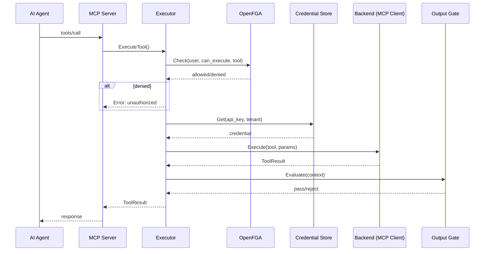

# ToolMesh Architecture

## Overview

ToolMesh is a secure, durable execution layer (middleware) between AI agents and enterprise infrastructure. It is **not** a tool itself — it orchestrates, authorizes, and secures the execution of tool calls on external MCP servers.

## The Six Pillars

### 1. Code Mode

LLMs can write typed JavaScript instead of error-prone JSON for tool calls. ToolMesh exposes two special tools:

- `discover_tools` — searches the tool catalog by regex (`pattern`) or BM25-ranked free text (`query`); output detail auto-scales from full TypeScript signatures down to a per-backend overview as the match count grows, capped at 50 KB per response
- `execute_code` — accepts JavaScript code and runs it in a sandboxed runtime (goja); `toolmesh.*` calls are dispatched through the execution pipeline, and `toolmesh.discover()` / `toolmesh.describe()` provide in-sandbox discovery without an extra MCP round-trip

### 2. Audit (Execution Trail)

Every tool execution is recorded as an audit entry. The audit store is pluggable:

- **`log` (default)** — structured slog output, zero dependencies, write-only
- **`sqlite`** — append-only SQLite database with indexed columns, queryable via SQL
- **Timeout enforcement** via `context.WithTimeout` on backend calls (`TOOLMESH_EXEC_TIMEOUT`)
- **Retries** handled by DADL `errors.retry_strategy` for REST backends

### 3. OpenFGA (Authorization)

Fine-grained, relationship-based authorization, on by default. In the default
`embedded` mode ToolMesh runs OpenFGA as a library inside its own process, on
a SQLite datastore in the data directory (`authz.db`). It creates the store
and the model on first start and writes the model again when a new version
changes it. In `external` mode it checks against an OpenFGA server operated
separately and never writes to it.

The embedded model keeps only the rules from configuration in the store:
**grants**, which user, role, plan, company or everyone may execute all tools,
the tools of a backend, the tools of a DADL access class, or single tools,
**denies** of the same form, which win over every grant, and **kits**, named
bundles of tools that a caller is granted as a whole. A kit is a role: the
store holds what its holders may execute, and holding it is a contextual
tuple. Grants come from a preset or from `config/authz.yaml`, denies and kits
from that file; ToolMesh writes them at startup and whenever the file
changes. Everything else is passed with each check as contextual tuples, so it
cannot drift from where it is configured:

```
caller (from authentication)      tool (from routing and DADL)
  user:<id> ─ member ─▶ company     tool:<name> ─ instance ─▶ instance:toolmesh
           ─ subscriber ─▶ plan                ─ backend ──▶ backend:<name>
           ─ assignee ─▶ role                  ─ access_class ▶ access_class:<class>
           ─ holder ─▶ kit                     ─ backend_access ▶ backend_access:<name>:<class>

tool#can_execute = (executor on the tool, its instance, its backend, its access class
                    or its backend_access) but not blocked on any of them
```

`backend_access` stands for the tools of one backend with one access
classification, so a kit can cover `graylog:read` without two kits ever
combining into more than each covers.

The backend is the one the call is routed to (longest-prefix match), not the
first part of the tool name. A tool listing is filtered with one check per
group of tools that share a backend and access class and have no grants of
their own, which gives the same result as checking every tool.

The authorization check happens before any tool execution (fail-closed): an
error in the check denies the call. If the check denies, the pipeline stops
immediately and the call is audited as `denied`; the denial names the kits
that would allow the call. Discovery also lists the tools a kit covers,
marked `grant_required`, and the meta-tool `tell_me_my_rights` answers what a
caller may do, per backend or as a preflight over the tools of a task. Both
are information only. A caller asks for a kit with the meta-tool
`request_grant`; an approver from `config/authz.yaml` approves it on the
approver API (`/grants`) with a key of its own, or on the approval page
(`/approve/<id>`) by signing a statement ToolMesh writes for the request with
the key of its BIP-322 address, possibly for fewer entries of the kit and less
time. The grant lives in Redis, or in process memory without one, until it
expires or is revoked, and every check passes the caller's granted kits as
contextual tuples: a whole kit as its role, a part of one as the entries
granted. `TOOLMESH_AUTHZ_MODE=disabled`
is the only way to skip the check; it is reported at startup and recorded in
the audit trail.

### 4. MCP Aggregation

The MCPAdapter connects to multiple external MCP servers and aggregates their tools:

- Tools are prefixed with the backend name: `memorizer_retrieve_knowledge`
- Routing is automatic based on the prefix
- Both HTTP (Streamable HTTP) and STDIO transports are supported

### 5. Credential Store

Credentials are injected at execution time within the executor pipeline scope. They never appear in prompts, logs, or model context.

Phase 1 uses an environment-variable-based store (`CREDENTIAL_<NAME>=value`).

### 6. Output Gate

A JavaScript policy engine (powered by goja) evaluates every tool result before it reaches the caller. Policies can:

- Reject requests (throw an error)
- Check rate limits
- Validate authentication state
- Filter or modify response content

## Execution Pipeline



## Project Structure

```
toolmesh/
├── cmd/
│   ├── toolmesh/       # Main entrypoint (MCP Server)
│   └── lint-dadl/      # CLI: Validate DADL composite files
├── internal/
│   ├── mcp/            # MCP Server (Streamable HTTP + STDIO)
│   ├── backend/        # ToolBackend interface + MCPAdapter
│   ├── executor/       # ExecuteTool pipeline (AuthZ → Creds → Gate → Exec → Audit)
│   ├── audit/          # Audit store interface + log/sqlite implementations
│   ├── authz/          # Authorization: embedded OpenFGA, external client, presets, grants
│   ├── grants/         # Kit requests, approvals and grants (request_grant, /grants)
│   ├── credentials/    # Credential store interface + EmbeddedStore
│   ├── gate/           # Output Gate (goja policy engine)
│   ├── userctx/        # UserContext propagation
│   └── config/         # Environment-based configuration
├── config/             # Backend configuration (backends.yaml)
├── tools/              # TypeScript tool definitions (canonical source)
└── docs/               # Documentation
```

## Extension Model

ToolMesh uses a registry-based extension model inspired by Go's `database/sql`
driver pattern. Three component types are extensible:

| Component | Registry | Built-in | Extension Point |
|-----------|----------|----------|-----------------|
| Credential Store | `credentials.Register()` | `embedded` | `CREDENTIAL_STORE=<name>` |
| Tool Backend | `backend.Register()` | `mcp`, `echo` | `config/backends.yaml` |
| Output Gate Evaluator | `gate.RegisterEvaluator()` | `goja` | `GATE_EVALUATORS=<list>` |

Extensions register themselves via `init()` functions. Enterprise extensions
live in a separate module and are included via Go build tags:

```
go build -tags enterprise ./cmd/toolmesh
```

The open-source core includes all interfaces and the built-in implementations.
Enterprise implementations (InfisicalStore, VaultStore, Compliance-LLM evaluator,
etc.) are available separately.
